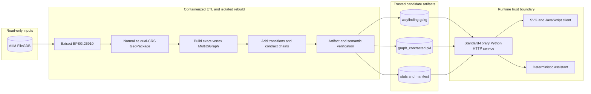
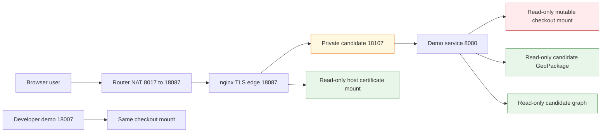
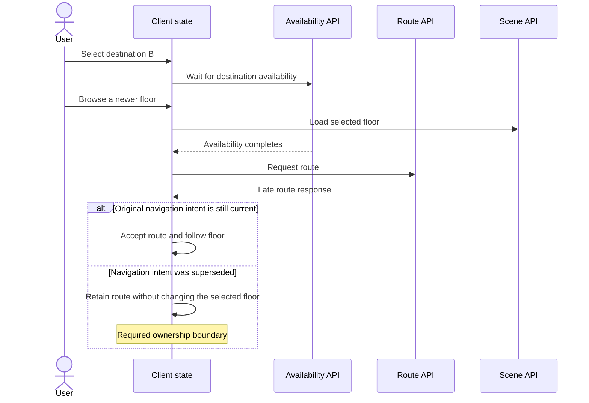

# SFU Indoor Wayfinding Repository Review

**Review date:** 2026-11-19

**Scope:** Repository at `main` (`5ca5186329e5dcf9df28a4f512280d7fc6c2d299`) plus the inherited, uncommitted DT-027–DT-030 working tree.

**Change policy:** This report is the only file produced by this review. Existing source, configuration, data, documentation, and artifacts were not modified.

## Executive summary

The repository has strong evidence discipline, explicit spatial-data limitations, a clearly separated artifact build pipeline, meaningful Docker/browser gates, and deliberately conservative no-route behavior. Its greatest risks are not global graph connectivity. They are:

1. accessibility metadata is sometimes promoted from naming conventions rather than verified access conditions;
2. known multipart geometry defects remain executable in the public candidate;
3. the public endpoint is machine-local and mutable rather than an immutable release;
4. delayed client requests can override newer navigation intent;
5. legacy ETL commands can overwrite accepted artifacts before validating prerequisites; and
6. CI does not enforce several of the gates used to support “complete” or “accepted” claims.

**Verdict:** useful and unusually transparent for a bounded design/demo workspace, but **not ready to be presented as an immutable, source-certified, production-ready navigation deployment**.

## Review basis and verification

Static review covered the runtime, ETL, routing, guidance, static client, Compose definitions, launchers, tests, ADRs, plans, reports, README, handoff, and the inherited dirty working tree. Raw geodatabases were not opened or modified.

A read-only Docker audit reported:

| Check | Result |
| --- | --- |
| Artifact `dataqa` marker gate | 23 passed, 1 expected skip |
| Focused artifact, routing, guidance, availability, topology tests | 157 passed, 1 expected skip |
| Uncommitted DT-027–DT-030 contract tests | 7 passed |
| Candidate artifact hash, manifest seal, and retained stage lineage | Pass |
| Fresh source-GDB QA | Not run |
| Fresh public/browser E2E for this review | Not run |

The Docker checks used the cached `wayfinding-build:local` image. They do not certify the published registry image or the current external endpoint.

## Architecture diagrams

### 1. Implemented data and runtime architecture

### 2. Current deployment and publication boundary

The immutable GIS artifacts are useful, but the application package and static client are bind-mounted from a mutable checkout. Artifact hashes therefore do not identify the complete running application.

### 3. Navigation request ownership race

## Prioritized findings

### P1 — Unsupported accessibility values are exposed as facts

**Evidence:** The category mapping assigns `accessible: true` to all elevator shafts and ramp corridors in [category_mapping.yaml](packages/wayfinding/src/wayfinding/etl/category_mapping.yaml#L32) and [category_mapping.yaml](packages/wayfinding/src/wayfinding/etl/category_mapping.yaml#L208). Normalization stamps inferred values as `verified_by="source_gdb_use_type"` in [normalise.py](packages/wayfinding/src/wayfinding/etl/normalise.py#L203), and the API exposes the values through [artifact.py](packages/wayfinding/src/wayfinding/demo/artifact.py#L283).

The reviewed artifact contained 31 positive flags derived from unit labels that do not establish usable access. It also contained 24 ordinary washrooms forced to `false` merely because an accessibility tag was absent. Every transition arc lacked `verified_by` and `verified_date`.

**Impact:** An elevator-shaft or ramp label does not verify dimensions, operation, slope, door access, landing clearance, surface, or wheelchair suitability. Users can receive unsupported destination facts, while the provenance fields suggest stronger evidence than exists.

**Improvement:** Preserve accessibility as `unknown` unless explicitly surveyed or source-tagged. Separate “source category says elevator/ramp” from “physically verified accessible.” Add provenance to transition-mode decisions without inventing survey identities or dates, and add record-level QA for permitted derivations.

### P1 — Known multipart geometry defects remain routable in the public candidate

**Evidence:** Multipart pathway coordinates are concatenated in stored sequence in [graph.py](packages/wayfinding/src/wayfinding/etl/graph.py#L367). [DT-017](docs/plans/DT-017.md#L5) records the unfinished source-reconciliation work. The reviewed candidate retained four physical source features that generated 41 joins between noncontiguous parts, plus 40 physical transition features with geometry/weight disagreements.

Guidance downgrades uncertain output in [guidance.py](packages/wayfinding/src/wayfinding/demo/guidance.py#L208), but the geometry can still be highlighted with route-following language.

**Impact:** Connectivity, hashes, and authoritative route weights do not prove that displayed geometry represents a physically walkable path. A TLS or topology release can therefore be operationally healthy while still publishing a source-fidelity defect.

**Improvement:** Complete DT-017 in isolated candidates. Preserve original source parts and spans, reject ambiguous joins, and keep affected geometry non-navigational until independently reviewed. Do not replace recorded cost with geometry length or invent gap connections.

### P1 — Legacy ETL targets can remove accepted artifacts before validation

**Evidence:** Public Make targets write directly into `build` in [Makefile](Makefile#L63), and extraction enables overwrite before validating the source in [run.py](packages/wayfinding/src/wayfinding/etl/run.py#L59) and [extract.py](packages/wayfinding/src/wayfinding/etl/extract.py#L67).

**Impact:** A failed legacy extraction can delete accepted artifacts, while individual stage targets can leave a mixed artifact generation. The running demo can consume that inconsistent state.

**Improvement:** Retire or quarantine destructive stage entrypoints. Require an unused isolated run ID, validate all prerequisites before writing, build into staging, and promote only complete artifact sets whose semantic checks and hash manifest pass.

### P1 — A delayed room selection can override newer floor navigation

**Evidence:** Destination selection waits for availability in [app.js](packages/wayfinding/src/wayfinding/demo/static/app.js#L440), while the route request captures `intentRevision` only when the request starts in [app.js](packages/wayfinding/src/wayfinding/demo/static/app.js#L1082). A read-only Docker reproduction observed a pending destination selection pull the view from a newer AQ floor choice to an older floor.

**Impact:** A route requested from an earlier click can silently supersede the user’s later browsing intent. Route generation and `requestGeneration` therefore protect request order, but not navigation ownership.

**Improvement:** Capture navigation identity at the original click and carry it through availability. Accept a late route only if useful, but do not navigate or change scenes when a newer intent owns the view. Add a deterministic delayed-response test covering this exact ordering.

### P1 — Completion evidence is not enforced by the normal PR gate

**Evidence:** The PR workflow runs only `tools/check-fast.sh` in [validate.yml](.github/workflows/validate.yml#L28). That script uses an aging explicit test list in [check-fast.sh](tools/check-fast.sh#L5). `make gates` omits browser, launcher, public TLS, and recovery E2E in [Makefile](Makefile#L19).

**Impact:** A pull request can pass CI while breaking PowerShell launchers, public TLS, recovery, candidate identity, or deployed browser behavior. Historical reports may be read as enforced release status even though their checks are manual.

**Improvement:** Classify tests by capability and add containerized jobs for full coverage, artifact QA, launcher parity, merged Compose, browser/API E2E, public TLS, and process recovery. Mark the intended release subset as required branch checks.

### P1 — Candidate startup is machine-local, mutable, and not reproducible from a fresh checkout

**Evidence:** The public environment selects a local image tag and machine-specific run/certificate configuration in [wayfinding-public.env](infra/wayfinding-public.env#L3). The candidate mounts source code and ignored `build/experiments` artifacts in [docker-compose.candidate.yml](infra/docker-compose.candidate.yml#L8). DT-030 explicitly limits its result to the local image in [DT-030.md](docs/reports/DT-030.md#L104).

**Impact:** A fresh checkout cannot recreate the public candidate without preexisting build artifacts, the local build image, external certificate files, and host-specific paths. Editing static client files can alter the public UI without rebuilding or restarting the backend.

**Improvement:** Make the public profile an explicitly named host-deployment profile, or publish a versioned application image plus sealed artifact bundle. Pin and expose image ID, source commit, artifact hashes, run ID, topology mode, and source-quality status together.

### P1 — Artifact hashes are checked after startup, not enforced before public exposure

**Evidence:** Candidate configuration pins paths and a run name, not expected hashes, in [docker-compose.candidate.yml](infra/docker-compose.candidate.yml#L14). Hash comparison is delegated to [verify_public_demo.py](tools/verify_public_demo.py#L42), which the normal launcher does not invoke before exposing the candidate.

**Impact:** A replacement file in the selected run directory may be served under the same run identity. Reported hash parity is point-in-time evidence rather than a release invariant.

**Improvement:** Store expected hashes in a checked-in or generated signed/sealed manifest. Fail health/startup if the artifact set differs, then expose a runtime provenance endpoint that matches the admitted manifest.

### P1 — TLS and certificate evidence is dated and renewal is not operationalized

**Evidence:** TLS tests are mostly static in [test_dt030_public_tls.py](packages/wayfinding/tests/test_dt030_public_tls.py#L8). The handoff records the certificate expiring on 2026-12-14 in [HANDOFF.md](docs/HANDOFF.md#L3). The browser gate is still restricted to its existing local/demo origins.

**Impact:** The repository has no automated expiry threshold, chain/hostname validation, public HTTPS browser gate, or renewal verification. The documented TLS state is already historical by the date of this review.

**Improvement:** Add a repeatable containerized TLS check for chain, hostname, expiry threshold, redirect, Host rejection, API parity, and real Chromium behavior. Schedule expiry monitoring and document certificate renewal/reload ownership as an operational procedure.

### P2 — Exact coordinate preservation is overstated after contraction

**Evidence:** Contraction drops the first coordinate of each subsequent segment without checking equality in [graph.py](packages/wayfinding/src/wayfinding/etl/graph.py#L1493). The reviewed candidate had 2,297 joins over 482 physical contracted chains where native endpoints differed within the same snap semantics.

**Impact:** All observed differences were under 1 cm, but “exact source-coordinate preservation” is technically false. Complete feature IDs and weight checks do not establish exact coordinate retention.

**Improvement:** Remove a coordinate only when it is exactly equal to the existing endpoint. Otherwise preserve segmented geometry or model a disclosed snap treatment. Add unequal-endpoint contraction fixtures.

### P2 — Directed no-route requests can raise an internal error

**Evidence:** Reachability uses weak connectivity as a precheck in [routing.py](packages/wayfinding/src/wayfinding/demo/routing.py#L151). Exhausted directed search raises `RuntimeError` in [routing.py](packages/wayfinding/src/wayfinding/demo/routing.py#L514), while the POST handler does not translate that exception into a no-route response in [server.py](packages/wayfinding/src/wayfinding/demo/server.py#L337).

**Impact:** Current accepted bidirectional artifacts did not reproduce the issue, but a future directed graph can classify a pair as connected and still fail with a 500 instead of a profile-specific 409.

**Improvement:** Treat component equality only as a necessary precheck. Convert exhausted directed search into explicit no-route JSON and test reverse traversal of a one-way synthetic edge.

### P2 — Public backend logging is not bounded like the proxy

**Evidence:** The proxy has explicit log rotation in [docker-compose.candidate.yml](infra/docker-compose.candidate.yml#L57), while the demo backend has no equivalent logging configuration in [docker-compose.candidate.yml](infra/docker-compose.candidate.yml#L7).

**Impact:** On a Docker daemon using unrotated `json-file` logging, request and health-check logs can grow indefinitely.

**Improvement:** Apply bounded logging to the candidate backend and distinguish application runtime privileges/resources from the broader build-tool image.

### P2 — Recovery testing demonstrates process restart, not host reboot recovery

**Evidence:** The recovery script kills the demo/nginx process and checks restart counts in [check-public-recovery.ps1](tools/check-public-recovery.ps1#L35). It does not restart Docker Desktop, reboot the host, or test intentional-stop semantics. The reports disclose those limits.

**Impact:** The `unless-stopped` design is reasonable, but reboot/Desktop startup recovery remains inferred rather than demonstrated.

**Improvement:** Rename the evidence “container process recovery,” and separately test Docker daemon restart and an authorized host-reboot scenario. Confirm Docker Desktop auto-start operationally without mutating user configuration during the test.

### P2 — Deterministic assistant capability messages are contradictory

**Evidence:** Exact directions are supported in [assistant.py](packages/wayfinding/src/wayfinding/demo/assistant.py#L66), but unsupported routing questions can state that no routing service exists in [assistant.py](packages/wayfinding/src/wayfinding/demo/assistant.py#L160).

**Impact:** Users are told both that routing exists and that routing does not exist. Unsupported phrasing is confused with absent system capability.

**Improvement:** Generate capability-aware refusals: acknowledge exact supported directions, then explain that proximity, travel time, live status, and unrestricted natural-language parsing are not supported. Retain source and accessibility limitations in every relevant answer.

### P2 — Launcher configuration contains obsolete service assumptions

**Evidence:** Launchers allocate/check ports for PostGIS, Redis, Martin, an API, web services, and Neo4j, while [docker-compose.yml](infra/docker-compose.yml#L22) publishes only the actual demo service.

**Impact:** Unrelated listeners on unused ports can block or change a launch even though the implemented stack does not consume them. Two substantial launcher implementations must maintain obsolete architecture metadata.

**Improvement:** Reserve only ports that correspond to real services. Centralize public/developer deployment metadata, and share gate and launch entrypoints between POSIX and PowerShell wrappers.

### P3 — Current documentation does not cleanly distinguish current and historical behavior

**Evidence:** Handoff contains current HTTPS guidance followed by sections labeled “current” for superseded HTTP endpoints in [HANDOFF.md](docs/HANDOFF.md#L3). README similarly mixes current HTTPS, legacy HTTP publication, and older UI behavior in [README.md](README.md#L172). System design places historical contraction metrics beside the newer exact-topology rule in [02-system-design.md](docs/02-system-design.md#L160).

Accessibility wording in [01-data-findings.md](docs/01-data-findings.md#L114) also implies stronger feasibility than elevator inventory alone supports, while another count claim says 39 `USE_TYPE` values even though the retained raw artifact has 62.

**Impact:** Operators and reviewers can select obsolete ports, misunderstand current UI behavior, conflate topology generations, or treat source labels as physical accessibility certification.

**Improvement:** Maintain one compact “current runtime/deployment” table with verification date and artifact identity. Move superseded ticket narratives under a historical heading. Label every graph count and route claim by topology mode and artifact generation. Use “stairs-excluded graph route” instead of “accessible route.”

## Recommended improvement sequence

1. **Correct accessibility semantics and provenance.** Change unsupported true/false destination derivations to unknown, add provenance for transition modes, and rebuild an isolated candidate.
2. **Protect artifact integrity.** Quarantine destructive ETL entrypoints, seal complete runs with expected hashes, and make candidate health fail on manifest mismatch.
3. **Address geometry fidelity.** Complete DT-017 and exact contraction-coordinate preservation before presenting the candidate as navigationally trustworthy.
4. **Fix request ownership.** Capture click-time intent and prevent late availability/route responses from navigating the user.
5. **Create an immutable release boundary.** Package runtime code, configuration, artifact manifest, and public proxy settings into versioned images/bundles.
6. **Unify gates.** Replace test-file whitelists and duplicate launcher policies with capability-based, containerized release gates.
7. **Operationalize TLS and recovery.** Add repeatable TLS/expiry/browser checks and distinguish process recovery from daemon/host recovery.
8. **Reconcile current documentation.** Collapse current instructions into one authoritative section and archive superseded endpoint/UI descriptions.

## What is working well

- Raw source and artifact service boundaries are explicit and read-only in the reviewed Compose setup.
- Native EPSG:26910 use, `VERTICAL_ORDER`, MultiDiGraph parallel-edge preservation, and measured fragmentation baselines were verified.
- Exact-vertex noding and contraction preserved topology and weights for the reviewed candidate, including reverse arc pairs.
- Both real artifacts admitted all 1,017 eligible room anchors on the same level without inventing zero-cost room traversal.
- Elevator-only filtering excluded stairs, and unsupported routes returned explicit no-route outcomes in the exercised real artifacts.
- The reports generally disclose local-image use, NAT-loopback uncertainty, lack of source certification, and the limits of browser/API evidence.
- The nginx edge is comparatively defensive: digest pinning, unprivileged execution, read-only filesystem, dropped capabilities, strict Host handling, and a fixed upstream Host.
- The repository distinguishes historical connectivity counts from topology changes and source-quality approval better than many similar GIS prototypes.

## Final assessment

The repository is a strong **bounded demonstration and evidence workspace**. Its routing implementation, conservative fragmented-network behavior, and disclosure-heavy reports are real strengths. The current public candidate should nevertheless be described as an **unpromoted, machine-local, source-limited demonstration**, not as a production or accessibility-certified navigation system.

The highest-value next step is to repair accessibility derivation and source geometry in isolated candidates, then enforce immutable artifact/runtime identity before any new external deployment claim.
